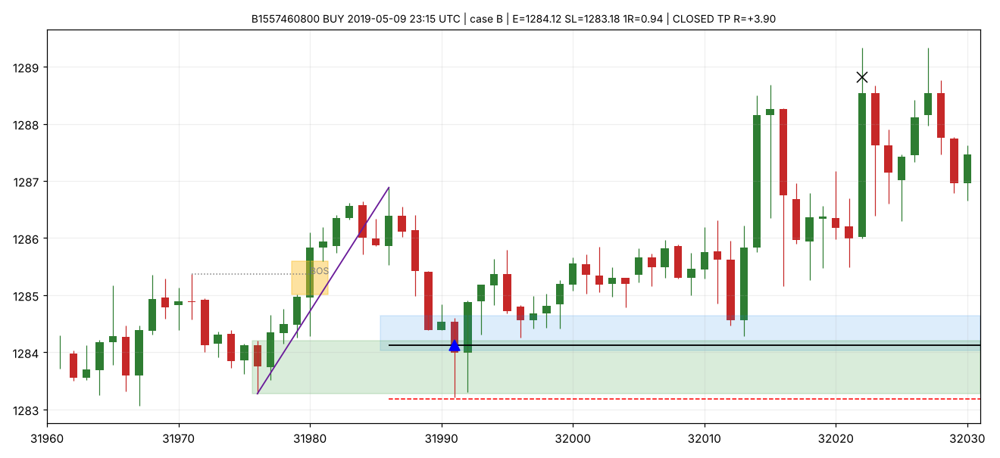
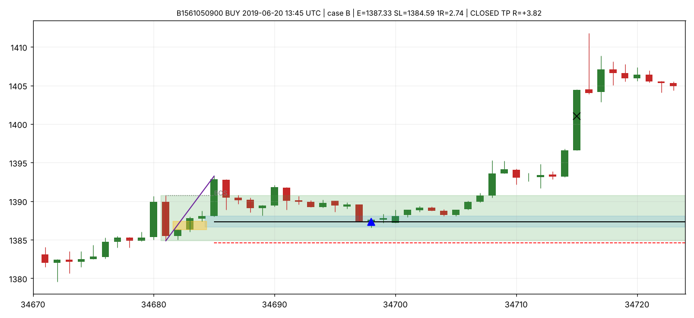
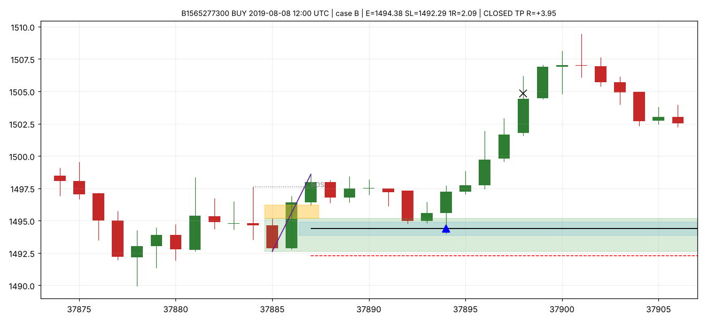
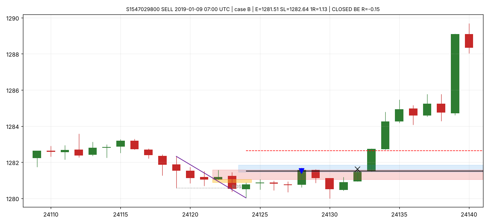
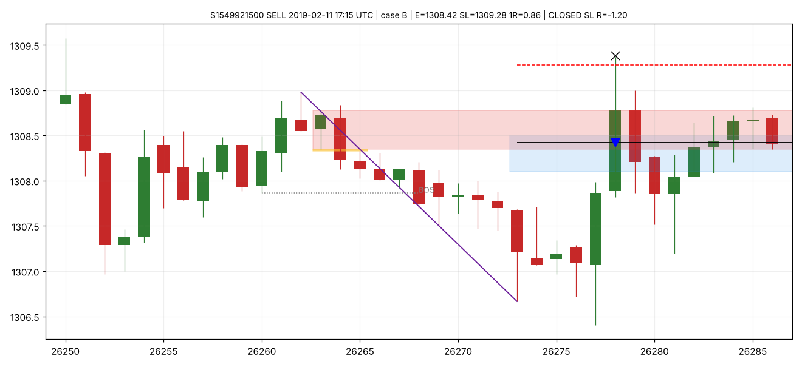
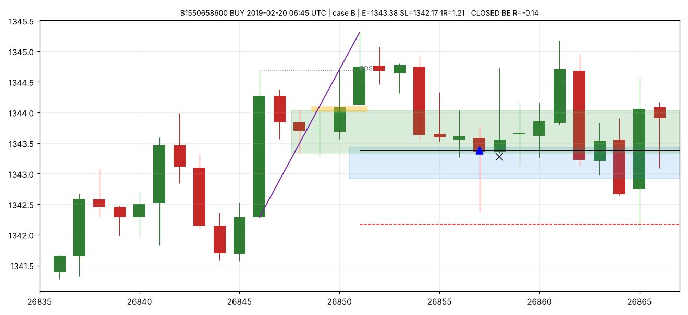
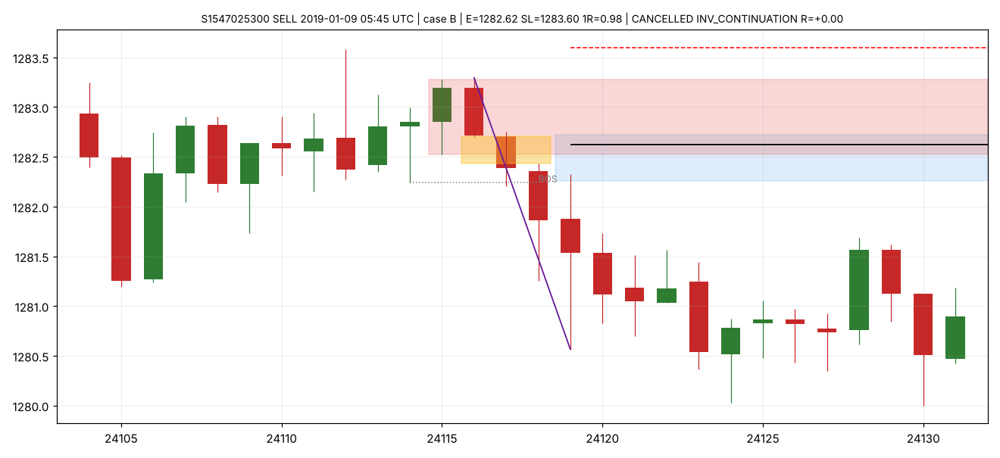
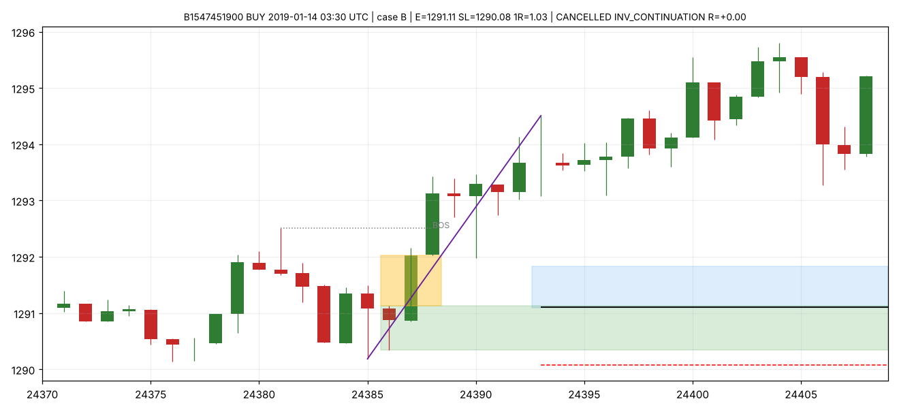

# Exemples de setups (revue visuelle)

Bougies M15 (heure UTC). Bleu : OTE 62-79 %. Vert/rouge : Order Block. Doré : FVG. Blanc/noir : entrée. Rouge pointillé : SL. Triangle : exécution. Croix : sortie. Ces graphiques servent à vérifier que les définitions algorithmiques correspondent à votre lecture ; ils ne sont pas sélectionnés pour leur résultat.

## B1557460800

B1557460800 BUY 2019-05-09 23:15 UTC | case B | E=1284.12 SL=1283.18 1R=0.94 | CLOSED TP R=+3.90

## B1561050900

B1561050900 BUY 2019-06-20 13:45 UTC | case B | E=1387.33 SL=1384.59 1R=2.74 | CLOSED TP R=+3.82

## B1565277300

B1565277300 BUY 2019-08-08 12:00 UTC | case B | E=1494.38 SL=1492.29 1R=2.09 | CLOSED TP R=+3.95

## S1547029800

S1547029800 SELL 2019-01-09 07:00 UTC | case B | E=1281.51 SL=1282.64 1R=1.13 | CLOSED BE R=-0.15

## S1549921500

S1549921500 SELL 2019-02-11 17:15 UTC | case B | E=1308.42 SL=1309.28 1R=0.86 | CLOSED SL R=-1.20

## B1550658600

B1550658600 BUY 2019-02-20 06:45 UTC | case B | E=1343.38 SL=1342.17 1R=1.21 | CLOSED BE R=-0.14

## S1547025300

S1547025300 SELL 2019-01-09 05:45 UTC | case B | E=1282.62 SL=1283.60 1R=0.98 | CANCELLED INV_CONTINUATION R=+0.00

## B1547451900

B1547451900 BUY 2019-01-14 03:30 UTC | case B | E=1291.11 SL=1290.08 1R=1.03 | CANCELLED INV_CONTINUATION R=+0.00

